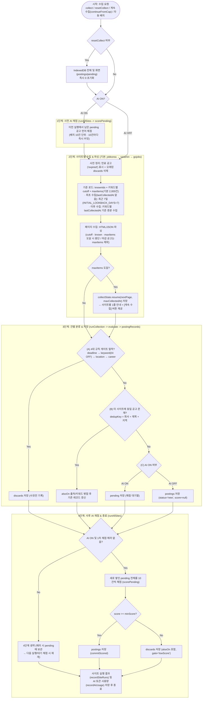
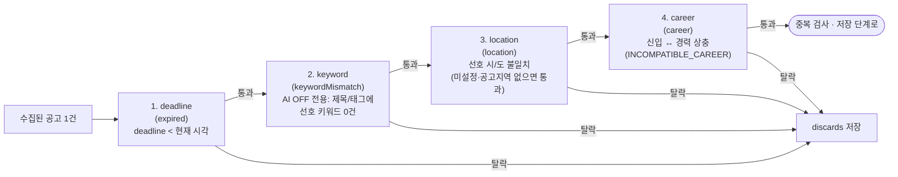
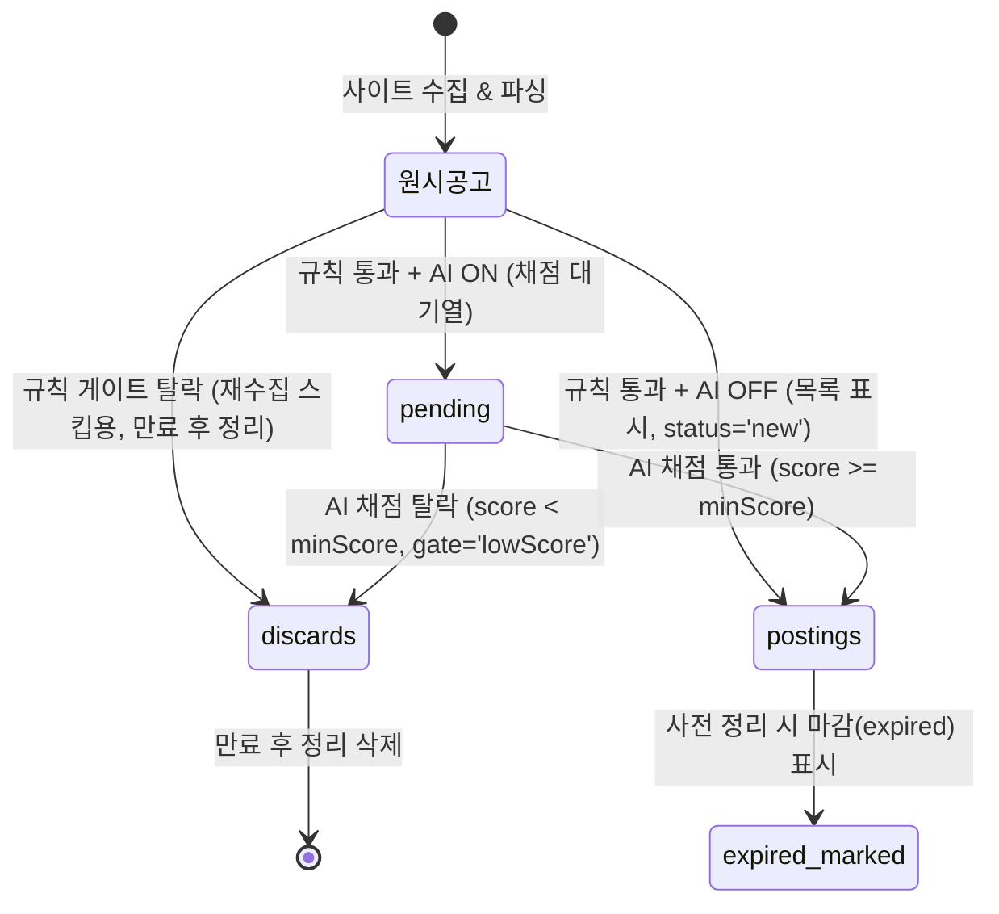

# 잡데이터 수집 · 분류 · 저장 다이어그램

> 원본 정리: [잡데이터-분류.txt](./잡데이터-분류.txt)  
> 검증 명령: `npm run verify` (또는 `npm run verify:workflow`)

---

## 1. 전체 처리 흐름 (4단계)

---

## 2. 조건 게이트 순서 (`src/engine/evaluate.ts` → `RULE_GATES`)

---

## 3. 저장소 상태 전이 (`IndexedDB: kr-job-finder`)

> **`collectState`**: `(site, keyword)`별 마지막 정상 수집 시각(`lastCollectedAt`) 및 `maxItems` 도달 시 이어받기 커서(`resume: { nextPage, maxCollectedAt }`)를 보관합니다.

---

## 4. 핵심 모듈 & AI 채점 방어 전략

| 구분 | 모듈 / 경로 | 역할 및 주요 동작 |
| :--- | :--- | :--- |
| 전체 조율 | `src/engine/runAllSites.ts` | AI 1차 채점 → 사이트별 수집 → AI 2차 채점 |
| 자동 배치 | `src/page/App.tsx`, `src/page/batchSchedule.ts` | 상단 체크 시 N시간 주기 자동 수집 (작업 중이면 완료 후 재예약) |
| 수집 / 파싱 | `src/engine/runCollection.ts` → `collect.ts` → `extractPostings.ts` | 증분 cutoff·knownIds·maxItems 기준 수집 및 HTML/JSON 추출 |
| 조건 게이트 | `src/engine/evaluate.ts` | `RULE_GATES` (`deadline` / `keyword` / `location` / `career`) 순서 검사 |
| 중복 / 레코드 | `src/engine/dedup.ts`, `src/engine/postingRecords.ts` | `dedupKey`(회사+제목+지역) 기반 타 사이트 출처(`alsoOn`) 병합 |
| AI 채점 | `src/engine/scorePending.ts` → `src/ai/provider.ts` (`gemini.ts` / `exaone.ts`, `parseScores.ts`, `pacer.ts`) | 배치 10건 단위, 응답 완료 후 간격 대기(Gemini 4초 / EXAONE 6초, 타임아웃 180초) **EXAONE 방어**: 429(혼잡) 시 3·6·10초 백오프 재시도, 비정형 JSON·`reason` 따옴표 복구, 타임아웃·오류 시 절반(5+5건) 자동 분할 재시도 |
| DB 저장소 | `src/storage/store.ts` | IndexedDB(`kr-job-finder`): `postings` / `pending` / `discards` / `collectState` |
